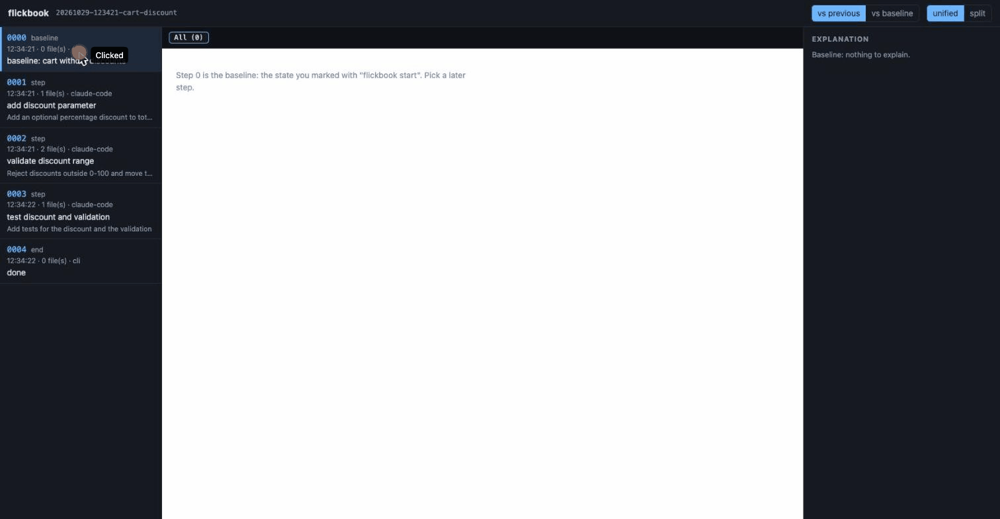

# flickbook

**AI 코딩 에이전트가 바꾼 것을 한 단계씩 되감아 읽는 도구.**
기점을 찍고, 어떤 에이전트(또는 본인)든 편집하게 둔 뒤, 단계마다 diff와 해설을 로컬 웹 화면에서 다시 봅니다. 아무것도 내 컴퓨터 밖으로 나가지 않습니다.

[English](README.md)



## 왜 필요한가

첫 직장에 선임은 있었습니다. 다만 다들 바빴고, 코드를 잘 쓰는 것과 잘 설명하는 것은 다른 재주였습니다. 「이 코드 잘못됐어」까지는 들었지만, 왜 잘못됐는지, 그 문제에 이름이 있다는 것(멱등성, 입력 검증, 경쟁 상태…)은 듣지 못했습니다. 이름을 모르니 검색도 할 수 없었습니다.

이제는 AI 가 코드를 많이 씁니다. 빨라졌지만, 아무도 제대로 읽지 않고 넘어가는 코드도 늘었습니다. [Anthropic 의 실험](https://www.anthropic.com/research/AI-assistance-coding-skills)에서 AI 도움을 받은 개발자는 방금 쓴 라이브러리에 대한 퀴즈 점수가 17% 낮았습니다. 모르는 채로 넘어가는 일이 이제 모두에게 더 쉽게 일어납니다.

flickbook 은 AI 가 바꾼 코드를 한 장씩 넘겨 보여 줍니다. 무엇을 요청했고, 실제로 무엇을 했고, 무엇이 다른지(빠진 것·요청 밖 변경), 어디를 직접 읽어 봐야 하는지, 그리고 거기 쓰인 개념의 이름까지.

- **주니어**는 바뀐 코드 옆에서 「왜」와 개념의 이름을 바로 보고, 혼자서도 찾아볼 수 있습니다.
- **시니어**는 AI 에게 맡기는 일이 늘수록 흐려지는 개념을 다시 만나고, 코드를 직접 따라 읽는 재미를 되찾고, 다른 사람에게 설명할 때 해설의 순서(요청한 것 → 한 것 → 차이 → 확인할 곳)를 그대로 빌려 쓸 수 있습니다.
- **팀**은 재생 화면을 화면 공유로 띄워 두고, AI 와 함께 바꾼 코드를 동료에게 한 단계씩 설명할 수 있습니다. 재생 화면은 내 컴퓨터에서만 열리고, flickbook 이 대신 공유해 주지는 않습니다(해설을 켜면 해설은 설정한 제공자를 거칩니다).

에이전트에게 변경을 시키면 파일 일곱 개가 한꺼번에 바뀌고, 나중에 긴 diff를 훑어보게 됩니다. flickbook 은 단계마다 작업 트리를 스냅샷해 두므로, 변경을 일어난 순서대로, 그 변경을 부른 프롬프트와 함께 읽을 수 있습니다.

가까운 도구와의 차이(2026-10-29 기준, 각 공개 README·문서 기준):

| 도구 | 무엇인가 | flickbook 과의 차이 |
|---|---|---|
| [Hunk](https://github.com/modem-dev/hunk) | 지금 상태의 diff 뷰어 | 타임라인과 사용자가 찍는 기점이 없음. flickbook 은 고른 기점부터 단계 열을 재생 |
| [Entire CLI](https://github.com/entireio/cli) | 커밋에 묶인 체크포인트를 원격으로 push 되는 ref 에 저장(기억·공유용) | flickbook 은 로컬 ref 에만 두고 push 하지 않음. 목적이 공유가 아니라 읽기 |
| Claude Code 체크포인트/rewind | 프롬프트 단위 되돌리기, Claude 전용, 해설 없음 | flickbook 은 파일을 건드리지 않는 읽기 전용이고, 어떤 에이전트·사람에게도 쓰이며, 해설이 있음 |
| [learning-opportunities](https://github.com/DrCatHicks/learning-opportunities) | 작업 뒤 퀴즈를 내는 스킬 | flickbook 은 diff 자체를 단계별로 보여 줌 |

## 설치

Node 20 이상과 git 이 필요합니다.

```sh
npm install -g flickbook
# 설치 없이 한 번만
npx flickbook --help
```

## 사용법

```sh
cd 내-저장소
flickbook start                         # 기점(0단계) 찍기
# ... 본인 또는 에이전트가 파일 편집 ...
flickbook step -m "검증 추가"            # 작업 트리를 다음 단계로 스냅샷
# ... 더 편집 ...
flickbook step -m "테스트 추가"
flickbook end                           # 마지막 스냅샷, 세션 종료

flickbook replay                        # 로컬 웹 화면 열기 (127.0.0.1)
flickbook list                          # 이 저장소의 세션 목록
flickbook rm <id>                       # 세션의 스냅샷 삭제
```

직전 단계와 달라진 것이 없으면 단계를 만들지 않습니다. 커밋하지 않은 변경과 추적되지 않는 새 파일도 포함합니다(`.gitignore`·`.git/info/exclude`·전역 제외 목록에 걸린 파일은 제외). 스냅샷은 `refs/flickbook/` 아래 숨은 ref 이며, 브랜치·HEAD·index·작업 파일은 건드리지 않습니다.

웹 화면에서는 `j` / `k` 로 단계를 이동하고, 「vs previous」(직전과 비교)와 「vs baseline」(기점부터 누적), unified 와 split 을 전환할 수 있습니다.

### 해설(선택 · 기본은 꺼짐)

```sh
git config flickbook.provider claude     # 또는 codex
git config flickbook.lang ko             # 기본값 en
flickbook explain                        # 최근 단계 (--step N · --all)
```

해설은 라벨이 붙은 다섯 부분으로 구성됩니다: **요청한 것**(기록된 프롬프트나 단계 메모에서 가져온, 내가 부탁한 내용. 기록이 없으면 없다고 밝히고 비교는 하지 않습니다), **실제로 한 것**(diff 가 실제로 바꾸는 것), **차이**(요청했지만 빠진 것과, 요청하지 않았는데 바뀐 것), **직접 확인할 곳**(diff 만으로는 확인할 수 없는 부분 위주로 꼼꼼히 읽어야 할 1~3곳), **쓰인 개념**(이 단계에 쓰였거나 썼어야 할 설계·엔지니어링 개념 1~3개. 입력 검증(input validation), 경계값(boundary values)처럼 영어 용어를 함께 적고 한 문장으로 풀어 주어, 무엇을 찾아보면 되는지 알 수 있습니다). 웹 화면에서 각 부분은 접고 펼 수 있는 카드이며, 차이·직접 확인할 곳·쓰인 개념은 펼친 채로 시작합니다. 요청을 기록하려면 Claude Code 훅이나 `flickbook step -m "..."` 를 쓰세요.

`git config flickbook.lang ko` 로 해설과 웹 화면을 모두 한국어로 바꿀 수 있습니다(기본값 `en`; `ko`, `ko-KR` 처럼 `ko` 로 시작하는 값은 한국어, 그 밖의 값은 영어). CLI 메시지와 서버가 돌려주는 오류 문구는 영어로 남습니다.

해설은 이미 설치된 `claude` 또는 `codex` CLI 를 쓰며, 빈 임시 디렉토리에서, 사용자 자신의 에이전트 설정과 떨어뜨려 실행합니다: `claude` 는 도구 없이 `--safe-mode`(CLAUDE.md·스킬·플러그인·훅·MCP 서버 없음)·`--strict-mcp-config`·`--disable-slash-commands` 로, `codex` 는 읽기 전용 샌드박스에서 `--ignore-user-config`·`--ignore-rules` 와 MCP 서버 없이 실행합니다. 버튼을 누르거나 `flickbook explain` 을 실행할 때만 생성되고, `.git/flickbook/explain/` 에 캐시되며, 생성된 뒤에는 단계를 고르는 즉시 보입니다.

### Claude Code 훅

`flickbook hook claude` 가 `~/.claude/settings.json`(또는 프로젝트의 `.claude/settings.json`)에 붙일 스니펫을 출력합니다.

```json
{
  "hooks": {
    "UserPromptSubmit": [
      { "hooks": [{ "type": "command", "command": "flickbook hook claude-prompt" }] }
    ],
    "Stop": [
      { "hooks": [{ "type": "command", "command": "flickbook hook claude-stop" }] }
    ]
  }
}
```

에이전트의 한 턴이 끝날 때마다 한 단계가 쌓이고, 그 턴의 프롬프트가 맥락으로 저장됩니다. 활성 세션이 없는 저장소에서는 아무것도 하지 않고 출력도 없으므로 전역 설치해도 조용합니다. flickbook 이 설정 파일을 대신 고치지는 않습니다.

## 개인정보

provider 를 설정하기 전에는 아무것도 컴퓨터 밖으로 나가지 않습니다.

- 스냅샷·메모·프롬프트 맥락은 저장소의 `.git` 안에만 있습니다.
- 웹 서버는 `127.0.0.1` 에만 바인드하고, 외부 자원을 불러오지 않으며, 다른 출처의 요청을 거부합니다.
- provider 를 설정하면 해당 단계의 diff(최대 60 KB)와 프롬프트 맥락이 그 CLI 뒤의 공급자에게 전송됩니다. 설정 전에는 전송되지 않습니다.
- 스냅샷에는 무시되지 않은 추적 안 되는 파일도 들어가므로, 큰 파일이나 무시 목록에 없는 `.env` 같은 비밀도 저장되고 provider 를 설정했다면 그 diff 가 전송됩니다. 그런 파일은 `.gitignore` 나 `.git/info/exclude` 에 넣으세요.
- `codex exec` 에는 Codex 홈의 `AGENTS.md` 같은 전역 지침 파일을 건너뛰는 옵션이 없어, 그 내용이 모델에 들어갈 수 있습니다.
- 한 저장소의 연결된 worktree 들은 세션 목록(ref)을 공유합니다. 활성 세션은 worktree 마다 따로입니다.
- 한 저장소에서 Claude Code 세션을 동시에 여럿 돌리면 대기 중인 프롬프트 맥락 하나를 공유하므로, 한 단계에 다른 세션의 프롬프트가 붙을 수 있습니다.
- 주의: `git push --mirror`, `git clone --mirror` 는 `refs/flickbook/*` 를 포함한 모든 ref 를 복사하며 그 안에 프롬프트가 들어 있습니다. 먼저 `flickbook rm <id>` 를 하거나 브랜치를 명시해 push 하세요. 일반 `git push` / `git clone` 은 이 ref 를 옮기지 않습니다.

## 개발

```sh
pnpm install --ignore-scripts
pnpm build && pnpm test
scripts/demo-fixture.sh        # 3단계 세션이 든 임시 저장소 생성
```

`scripts/demo-fixture.sh` 는 JSON 파일의 고정 문구를 돌려주는 데모 전용 `fixture` provider 를 씁니다. AI 호출이 없고 실사용용이 아닙니다. 제품 이름은 `src/name.ts` 한 곳에 있습니다.

## 라이선스

MIT
