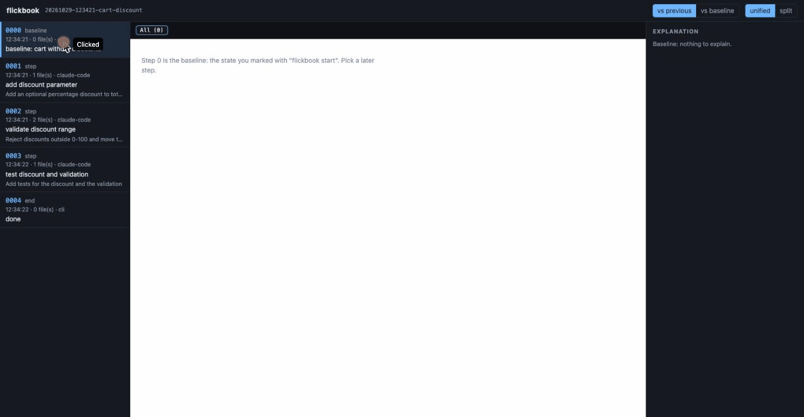

# flickbook

**Replay what your AI coding agent changed, step by step: what you asked for, what it actually did, and the concepts involved.**

Mark a baseline, let an agent (or yourself) edit, record each step with `flickbook step` (or let the Claude Code hook do it), then flip through every step's diff and explanation in a local web UI. Nothing leaves your machine unless you turn on explanations.

[한국어](README.ko.md)



```sh
npx flickbook start                 # mark the baseline
npx flickbook step -m "add login"   # after each change (or use the Claude Code hook)
npx flickbook replay                # open the step-by-step view
```

## Why

When I started my first developer job, I had senior colleagues, but they were busy, and writing good code is a different skill from explaining it. I'd hear "this is wrong," but not why, and not that the problem had a name (idempotency, input validation, race conditions...). Without the name I couldn't even search for it.

Now AI writes a lot of the code, and more of it gets accepted without anyone really reading it. In a small, preliminary [Anthropic study](https://www.anthropic.com/research/AI-assistance-coding-skills) (52 mostly junior developers learning a new library), the AI-assisted group averaged 50% on a follow-up quiz versus 67% for those who coded by hand. The people who scored well used AI to understand the code, asking for explanations and conceptual questions, not just to produce it. flickbook is built for that habit: for juniors who want the "why" and the name next to each change, and for anyone who has to read AI changes they didn't write.

The longer story is in [Why I built flickbook](docs/why.md).

How it differs from nearby tools (as of 2026-10-29, from their public READMEs/docs):

| Tool | What it is | How flickbook differs |
|---|---|---|
| [Hunk](https://github.com/modem-dev/hunk) | Diff viewer for the current state | No timeline and no baseline you pick; flickbook replays a sequence of steps from a baseline you choose |
| [Entire CLI](https://github.com/entireio/cli) | Commit-linked checkpoints stored in their own refs and pushed to the remote by default, for memory and sharing | flickbook keeps everything in local refs and never pushes; the point is reading, not sharing |
| Claude Code checkpoints / rewind | Per-prompt undo, Claude only, no explanations | flickbook is read-only for your files, works with any agent or a human, and adds explanations |
| [learning-opportunities](https://github.com/DrCatHicks/learning-opportunities) | A skill that quizzes you after the work | flickbook shows the diff itself, step by step; the two work well together |

## Install

Requires Node 20+ and git.

```sh
npm install -g flickbook
# or run once without installing
npx flickbook --help
```

## Usage

```sh
cd your-repo
flickbook start                         # mark the baseline (step 0)
# ... you or your agent edit files ...
flickbook step -m "add validation"      # snapshot the working tree as the next step
# ... more edits ...
flickbook step -m "add tests"
flickbook end                           # final snapshot, closes the session

flickbook replay                        # open the local web UI (127.0.0.1)
flickbook list                          # sessions in this repo
flickbook rm <id>                       # delete a session's snapshots
```

A step with no changes since the previous one is skipped. Uncommitted changes and untracked files are included (anything ignored by `.gitignore`, `.git/info/exclude` or your global excludes is not). Snapshots are hidden refs under `refs/flickbook/`; your branch, HEAD, index and files are never touched.

In the web UI use `j` / `k` to move between steps, switch between "vs previous" and "vs baseline" (cumulative), and between unified and split.


### Timeline and size & nesting

Between the header and the step list the web UI shows a timeline: one row per file the session changed (biggest total change first), one column per step (aligned with the step list). A cell is shaded by `log(added + removed)` and split green/red by the added/removed ratio; hover for `+a −r`. A binary file shows `bin`; a renamed file sits on its new path's row. Click a cell to open that step, "vs previous", on that file's diff.

Under the column numbers, four small lines are labeled **Size & nesting**. Each is the difference from step 0 (the dashed line is zero):

| Line | What it is | It can tell you | It cannot tell you |
|---|---|---|---|
| Lines changed since start | lines added plus lines removed between step 0 and this step (churn, not net) | how much text differs from the start | whether the change is right; blank lines and comments count; a reformat-only step raises it; code written and then deleted again disappears |
| Files touched since start | number of files that differ from step 0 | how widely the session spread | how big each change is; a rename counts as one file |
| Indent total vs start | leading whitespace (tab = 4 columns) summed over the non-blank lines of every file the session touched, minus the same at step 0 | whether code moved toward deeper or shallower nesting overall | a reformat-only step (tabs to spaces, re-wrapped lines, re-indented blocks) moves this line without any change in logic; more lines also raise it; deleting a file or code reads as a drop |
| Deepest indent vs start | the largest leading-whitespace width on any one non-blank line, same file set, minus step 0 | whether one spot got much deeper | it is a single line; a wrapped argument list or a long literal counts like a nested block |

These numbers describe how much changed and how it is indented. They are not a quality score and say nothing about correctness, design or readability, so read the diff. Binary files, files over 1 MiB, files past a 64 MiB read budget per computation, paths that are not valid UTF-8 or contain a newline (reason `unreadable`), and common lockfiles (`package-lock.json`, `pnpm-lock.yaml`, `yarn.lock`, `Cargo.lock`, `poetry.lock`, `Gemfile.lock`, `composer.lock`, `go.sum`) are left out of the numbers; `GET /api/sessions/<id>/stats` (same token as the rest of the API) lists them under `unmeasured` with a reason (`binary`, `too-large`, `budget`, `unreadable`, `lockfile`). Nothing is computed by running your code; the numbers come from git objects only.

### Explanations (optional, off by default)

Explanations are written by an AI and can be wrong. That is why every explanation includes places to check yourself; treat it as a guide to what to read, not as the answer. Text inside the diff (comments, strings, file contents) can also try to steer the explanation, which is one more reason to read the diff yourself.

```sh
git config flickbook.provider claude
git config flickbook.lang ko             # default: en
flickbook explain                        # latest step (or --step N / --all)
```

Each explanation has five labeled parts: **Requested** (what you asked for, from the recorded prompt and/or the step note; if no request was recorded it says so and makes no comparison), **Done** (what the diff actually changes), **Gap** (what was asked but is missing, and what changed without being asked), **Check yourself** (1-3 places to read closely, especially what the diff alone cannot confirm), and **Concepts** (1-3 standard design/engineering concepts the step touches or should have applied, such as input validation or boundary values, each with one plain sentence, so you know what to look up). In the web UI each part is a collapsible card; Gap, Check yourself and Concepts start open. To record the request, use the Claude Code hook or `flickbook step -m "..."`.

`git config flickbook.lang ko` switches both the explanations and the web UI to Korean (default `en`; `ko`, `ko-KR` and the like mean Korean, any other value falls back to English). CLI messages and error texts from the server stay in English.

In this version explanations use the Claude Code CLI (`claude`) you already have; support for other agents such as Codex is planned for a later version, and `flickbook.provider codex` is refused with a message. It runs in an empty temporary directory and is kept away from your own agent setup: no tools, `--safe-mode` (no CLAUDE.md, skills, plugins, hooks or MCP servers), `--strict-mcp-config` and `--disable-slash-commands`. It gets a minimal environment (`PATH`, `HOME`, `USER`/`LOGNAME`, `LANG`/`LC_*`, `TERM`, `TMPDIR`, proxy and CA-certificate variables, `XDG_*` directories, and `ANTHROPIC_*` / `CLAUDE_*`), so other secrets in your shell, such as cloud keys or tokens, are not passed on. Explanations are generated only when you click the button or run `flickbook explain`, cached in `.git/flickbook/explain/`, and shown immediately once they exist. To practice reading first, run `git config flickbook.reveal click` (default `immediate`; any other value means `immediate`): an existing explanation and the agent's own summary then stay behind a "Reveal explanation" button, while the prompt (what was asked) stays visible.

### Claude Code hook

`flickbook hook claude` prints a snippet to paste into `~/.claude/settings.json` (or a project's `.claude/settings.json`):

```json
{
  "hooks": {
    "UserPromptSubmit": [
      { "hooks": [{ "type": "command", "command": "flickbook hook claude-prompt" }] }
    ],
    "Stop": [
      { "hooks": [{ "type": "command", "command": "flickbook hook claude-stop" }] }
    ]
  }
}
```

As a Claude Code plugin (it calls the same `flickbook hook` commands, so the CLI still has to be on PATH; use either the plugin or the snippet, not both):

```
/plugin marketplace add Milo-JY/flickbook
/plugin install flickbook@flickbook
```

Then run `/flickbook:start` in a repository.

Either way, each finished turn becomes one step, with your prompt stored as its context. The hooks do nothing (and print nothing) in repositories without an active session, so a global install is quiet. flickbook does not edit your settings for you.

## Privacy

Nothing leaves your machine until you set a provider.

- Snapshots, notes and prompt context live inside your repository's `.git` directory.
- The web server binds to `127.0.0.1` only, loads no remote assets, and rejects requests from other origins. Each `flickbook replay` run makes a new random token and puts it in the fragment of the URL it opens (`#t=...`, never sent in a request line or Referer); the data API answers only requests that carry it, so other users on the same machine are kept out.
- If you set a provider, the step's diff (up to 60 KB) and the prompt context are sent to the provider behind that CLI. Not before.
- Snapshots include untracked files that are not ignored, so a large file or a secret such as an unignored `.env` is stored too and, if a provider is set, its diff is sent. List such files in `.gitignore` or `.git/info/exclude`.
- The `claude` process only receives the minimal environment listed above, not your full shell environment. Cloud credentials are passed only for the cloud Claude Code is set to use: `AWS_*` when `CLAUDE_CODE_USE_BEDROCK`, `CLAUDE_CODE_USE_MANTLE` or `CLAUDE_CODE_USE_ANTHROPIC_AWS` is set, `GOOGLE_*`/`CLOUD_ML_*`/`GCLOUD_*` when `CLAUDE_CODE_USE_VERTEX` is set.
- Linked worktrees of one repository share the list of sessions (the refs); the active session is per worktree.
- Concurrent Claude Code sessions in one repository share one pending prompt context, so a step can carry another session's prompt.
- Caveat: `git push --mirror` and `git clone --mirror` copy all refs, including `refs/flickbook/*`, which contain your prompts. Run `flickbook rm <id>` first, or push branches explicitly. A normal `git push` / `git clone` does not transfer them.

## Development

```sh
pnpm install --ignore-scripts
pnpm build && pnpm test
scripts/demo-fixture.sh        # builds a throwaway repo with a 3-step session
```

`scripts/demo-fixture.sh` uses a demo-only `fixture` provider that returns canned text from a JSON file. It makes no AI call and is not meant for real use. The product name lives in `src/name.ts`.

## License

MIT
